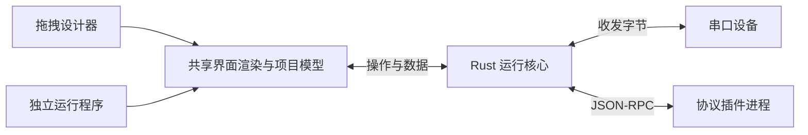

# 上位机 UI 设计工具方案（首版 Windows x64）

| 项目 | 内容 |
| --- | --- |
| 方案版本 | v0.2 |
| 确认日期 | 2026-10-15 |
| 实施状态 | 待实施；已完成方案文档及留痕规则，尚未开始应用开发 |
| 基线变更 | CHG-0001 |
| 最近变更 | CHG-0002：前端采用 Vue 与 Fluent Design，首版仅交付 Windows x64 |
| 变更记录 | [CHANGELOG.md](CHANGELOG.md) |
| 协作规则 | [AGENTS.md](../AGENTS.md) |

本文保存已确认的技术方案。后续方案调整更新本文并记录版本及变更原因；历史内容由 Git 保留。实施状态依据实际交付和验证更新，计划中的能力不代表已经实现。

## 1. 总体方案

采用 **Tauri 2 + Vue 3/TypeScript + Fluent UI Web Components + Rust**，实现“拖拽设计 → 配置串口和协议 → 绑定操作与数据 → 预览调试 → 导出独立程序”的完整流程。

已确定的范围：

- **首版平台**：仅 Windows 10/11 x64；设计器、独立运行程序和示例协议插件均按此范围交付。
- **使用方式**：工程师通过低代码搭建界面，开发者编写协议插件。
- **首版通信**：串口。
- **交付形式**：包含 UI、通信后端、协议插件及运行依赖的独立运行包。
- **交互逻辑**：配置动作、数据绑定和轮询；复杂设备逻辑由协议插件实现。

设计器和运行程序共享渲染模块及 Rust 运行核心，确保预览与发布后的行为一致。

## 2. 设计器与用户操作

### 工作区布局

左侧提供组件库和页面列表，中间是设计画布，右侧编辑属性、数据绑定及事件，底部显示设备资源、通信日志和错误。

前端使用 Vue 3 Composition API、TypeScript、Vite；画布采用 DOM 绝对定位，使用 `vue3-moveable` 实现移动、缩放和吸附，使用 `vue3-selecto` 实现框选。

### Vue 与 Fluent Design 组件库

- 选用微软官方的 [Fluent UI Web Components](https://github.com/microsoft/fluentui/tree/master/packages/web-components)，包名为 `@fluentui/web-components`，采用 MIT 许可。使用 3.x API，本次核实的稳定版本为 3.1.3；实施时从该版本开始验证并提交依赖锁文件。
- 该库基于 Web Components，按 [Vue 自定义元素集成规则](https://vuejs.org/guide/extras/web-components.html) 接入。在 Vite 的 Vue 插件编译配置中，将 `fluent-` 前缀识别为自定义元素，按需注册所用组件。
- 建立共享 Vue 适配层，统一控件属性、类型、事件和 `v-model`；输入框、下拉框、开关的值通过 DOM 属性及原生事件映射，避免将复杂值序列化为 HTML 字符串属性。
- 按 3.x 当前接口配置主题和设计令牌；设计器、预览和 Runner 共用组件适配层及主题，确保字体、间距、颜色、焦点和禁用状态一致。依赖和主题资源均本地打包。
- Fluent 组件用于按钮、表单、菜单、对话框等通用界面；数值显示、状态灯、曲线和日志等上位机专用控件通过共享 Vue 渲染组件实现，并使用相同设计令牌。
- 依赖核实来源：[npm 包元数据](https://registry.npmjs.org/@fluentui%2Fweb-components)、[当前官方接入与主题说明](https://github.com/microsoft/fluentui/blob/master/packages/web-components/README.md)。旧版接入示例须核对 3.x API 后使用。

### 首版设计能力

- 多页面，页面设计尺寸可配置，默认 1280×720；运行时等比缩放、居中显示。
- 控件拖放、调整尺寸、多选、对齐、复制、删除、层级调整、撤销和重做。
- 基础控件：文本、按钮、输入框、数值显示、下拉框、开关、状态灯、分组框、实时曲线和日志面板。
- 属性配置覆盖位置、尺寸、字体、颜色、标题、数值格式。
- 图片和字体随项目保存，运行时不依赖在线资源。

### 串口组件的操作体验

“串口连接”属于非可视资源，可以被多个控件共用；同时提供可直接拖入页面的“串口控制面板”。

典型操作：

1. 添加串口连接，设置端口、波特率、数据位、停止位和校验。
2. 为连接选择协议插件，并填写插件提供的设备参数。
3. 添加按钮，将点击事件绑定为“打开连接”“关闭连接”或某个协议命令。
4. 将数值、状态灯和曲线绑定到协议数据点。
5. 配置命令参数，例如从输入框读取目标值。
6. 进入预览，连接真实设备，检查返回数据和通信日志。
7. 导出 Windows x64 独立运行包。

编辑模式不执行设备操作。首版采用手动连接和故障后的手动恢复；导出的程序保留串口设置入口，便于换电脑后重新选择端口。

## 3. 通信核心与协议插件接口

### 职责划分

| 模块 | 职责 |
| --- | --- |
| Rust 运行核心 | 串口枚举和生命周期、字节收发、插件进程管理、命令调度、轮询、数据状态和日志 |
| 协议插件 | 组帧、分帧、校验、设备应答关联、协议超时、数据解析及命令实现 |
| 界面 | 展示数据、收集输入、触发已声明的动作 |

Rust 使用 Tokio 和 `tokio-serial`。每个串口连接绑定一个协议实例、启动一个插件进程；项目可以配置多个独立连接，同一端口禁止重复占用。Rust 宿主独占串口，协议插件通过宿主收发字节。

### 插件形态

首版协议包包含清单、配置描述、Windows x64 可执行文件和必要依赖。由产品自己的 Rust 插件管理器发现并启动，新增协议无需重新编译设计器；清单声明平台和架构，导出时检查与 Windows x64 运行模板一致。

不将 Tauri 的编译期插件机制作为用户协议扩展接口。

插件接口采用 **标准输入输出上的 JSON-RPC 2.0**：

- UTF-8 编码，每行一条消息；二进制字节使用 Base64。
- `stdout` 专用于协议消息，`stderr` 用于日志。
- 支持版本握手、初始化、接收串口字节、请求发送字节、执行命令、返回结果、发布数据点和关闭。
- 插件声明配置项、数据点、命令及参数类型，用于自动生成设计器表单和绑定选项。
- 首版提供 Rust SDK、示例协议和模拟设备；其他语言可以按同一接口接入。

### 项目与绑定接口

项目使用带 `schemaVersion` 的 JSON，记录页面、控件、连接、协议实例、绑定、动作和资源引用；插件版本固定记录在项目中。

- 数据点支持数字、文本、布尔值和枚举，并携带时间戳及有效状态。
- 控件属性可以绑定数据点；按钮等事件可以调用连接操作、协议命令和页面跳转。
- 命令参数来自常量或控件输入。写设备必须通过明确配置的动作触发。
- 启用状态、可见状态支持绑定布尔数据点；首版不引入任意脚本或表达式语言。
- 同一连接的命令串行执行，轮询繁忙时跳过当前周期，避免请求堆积。

串口拔出、插件崩溃或通信超时必须反馈到界面。连接故障时结束待处理调用、将关联数据标记为失效；控制命令不自动重发。

## 4. 独立程序生成与兼容性

采用**预编译 Runner 模板组装发布**，无需用户现场编译。

发布流程固定为：

> 校验项目 → 检查 Windows x64 插件 → 复制 Runner → 加入项目、资源与插件 → 生成清单 → 打包

- 首版输出 Windows x64 ZIP 运行目录，携带对应架构的固定版本 WebView2。
- 设计器、Runner 和示例插件均在 Windows 构建环境生成，Rust 目标为 `x86_64-pc-windows-msvc`，并在 Windows 10/11 x64 验证。
- 设计器随安装包提供 Windows x64 运行模板，导出时组装项目和插件，使用者无需安装 Rust、Node 或编译工具。
- 缺少 Windows x64 插件、平台或架构不匹配、绑定目标不存在或版本不兼容时，阻止导出并定位问题。
- Runner 支持 `--project` 指定项目路径；启动器传入绝对路径，避免依赖工作目录。
- 项目文件作为发布内容读取，端口选择、窗口设置和日志保存到用户目录，并按项目 ID 隔离。
- 首版支持自定义窗口标题；原生程序图标和文件版本信息沿用 Runner 模板。

默认按离线运行设计，但设备驱动和串口访问权限属于目标系统的部署条件。启动前检查运行依赖，并提供明确错误信息。

Windows 10 的固定 WebView2 需要处理其目录访问权限，具体遵循 [Microsoft 分发要求](https://learn.microsoft.com/en-us/microsoft-edge/webview2/concepts/distribution#the-fixed-version-runtime-distribution-mode)。在创建 WebView 前检查包内运行时路径和必要权限；无法满足时提供原生错误提示。Windows 运行包以本地磁盘目录为部署基线。

Linux 及其他平台或架构的设计器、运行模板、插件构建、打包和兼容性验收均不纳入首版；后续如需扩展，以新的方案变更确定范围。

## 5. 实施顺序与验收

以下阶段均处于**待实施**状态。

| 阶段 | 交付内容 | 验收标准 |
| --- | --- | --- |
| ① 验证通信与发布基础 | 最小 Tauri Runner、Rust 串口核心、插件 SDK、示例插件和模拟设备 | Windows 10/11 x64 均可打开串口、执行命令、解析结果，并从独立运行包启动 |
| ② 完成可视化设计 | Vue 与 Fluent 组件适配层、画布、控件、属性编辑、页面和项目保存 | 完成拖拽、调整、撤销、保存及重开，布局和属性保持一致，Fluent 控件值和事件正常同步 |
| ③ 完成低代码交互 | 设备资源、数据绑定、事件动作、轮询和预览 | 无需编写界面代码即可搭建“连接—读取—显示—设置参数”的上位机 |
| ④ 完成发布闭环 | Windows x64 模板管理、项目检查、组包和运行设置 | 导出的程序在 Windows 10/11 x64 脱离设计器和开发工具正常运行 |

重点测试：

- **串口与协议**：分包、粘包、校验失败、响应超时、拔插、端口占用、权限不足。
- **插件生命周期**：启动失败、版本不兼容、异常退出、关闭时残留进程。
- **界面一致性**：编辑保存后重开、预览与发布一致；持续更新数据时仍能正常操作界面。
- **Vue 与 Fluent 集成**：在 Windows WebView2 中验证输入框、下拉框、开关的值同步、事件、禁用状态、键盘焦点，以及弹层和画布拖拽、缩放的交互；预览和 Runner 使用一致主题。
- **独立部署**：无 Rust、Node 和设计器的 Windows 10/11 x64 环境中离线运行，验证中文路径、空格路径、更换端口以及插件架构不匹配时的导出拦截。
- **完整演示**：用示例设备完成打开串口、读取数值、显示曲线、写入参数、关闭串口，以及异常恢复。

首版默认只开放协议插件，不开放自定义 UI 插件；不包含 TCP/UDP、脚本引擎、流程编排、历史数据库、报警配方、插件热更新及源码生成。完成上述闭环后，再沿现有连接和协议接口扩展。

## 6. 文档维护与变更留痕

- 本文保存当前有效方案；技术决策或范围变化时更新版本，并在 [CHANGELOG.md](CHANGELOG.md) 说明变更原因和影响。
- 项目采用 Git 文件差异与中文变更日志共同留痕，覆盖方案、代码、配置、依赖、测试和发布相关源文件。
- 每次完整逻辑变更分配唯一编号，例如 `CHG-0001`。同一事项的文件修改、方案同步及日志更新纳入同一提交，不按每次保存单独记录。
- 日志包含北京时间、编号、内容、原因、影响、实际验证结果和未完成事项。提交说明包含变更编号，完成后反馈提交 ID。
- 历史日志采用追加或追加更正的方式维护；历史方案和文件差异由 Git 保存。日志不回填包含自身的提交哈希，避免循环更新。
- 协作过程遵循根目录 [AGENTS.md](../AGENTS.md)，保护工作区已有修改，如实区分计划、实施和验证状态。

本次文档基线不代表软件功能已经实现；当前没有应用源码、构建产物或设备测试结果。
