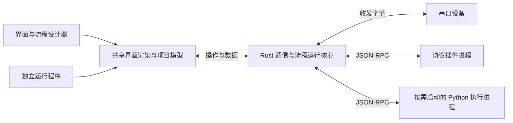

# 上位机 UI 设计工具方案（首版 Windows x64）

| 项目 | 内容 |
| --- | --- |
| 方案版本 | v0.4（首版实现基线） |
| 确认日期 | 2026-10-15 |
| 实施状态 | 已实现首版设计器、共享运行核心、协议插件、Python 执行及 Windows x64 发布；本机验证与尚需目标环境验收见 [VERIFICATION.md](VERIFICATION.md) |
| 基线变更 | CHG-0001 |
| 最近变更 | CHG-0004：执行方案，建立应用源码、接口、构建与测试及独立运行包 |
| 变更记录 | [CHANGELOG.md](CHANGELOG.md) |
| 协作规则 | [AGENTS.md](../AGENTS.md) |

本文保存已确认的技术方案。后续方案调整更新本文并记录版本及变更原因；历史内容由 Git 保留。实施状态依据实际交付和验证更新，计划中的能力不代表已经实现。

## 1. 总体方案

采用 **Tauri 2 + Vue 3/TypeScript + Fluent UI Web Components + Rust**，实现“拖拽设计 → 配置串口和协议 → 连接流程及插入代码块 → 数据绑定 → 预览调试 → 导出独立程序”的完整流程。

已确定的范围：

- **首版平台**：仅 Windows 10/11 x64；设计器、独立运行程序和示例协议插件均按此范围交付。
- **使用方式**：工程师通过低代码搭建界面和流程，开发者通过 Python 代码块补充业务计算、通过协议插件扩展设备协议。
- **首版通信**：串口。
- **交付形式**：包含 UI、通信后端、协议插件及运行依赖的独立运行包。
- **交互逻辑**：首版包含基础流程节点、Python 代码节点、数据绑定和轮询；协议组帧、解析及设备事务仍由协议插件实现。



设计器和运行程序共享渲染模块、项目模型及 Rust 通信与流程运行核心，确保预览与发布后的行为一致。流程编辑体验借鉴 Node-RED，采用自有轻量执行器；首版不承诺兼容 Node-RED 流程文件、运行时 API 或第三方节点包。

## 2. 设计器与用户操作

### 工作区布局

提供“界面设计”和“逻辑流程”两个工作区。界面设计左侧为组件库和页面列表，中间是设计画布，右侧编辑属性、数据绑定及事件；逻辑流程使用节点库、连线画布及节点参数/代码编辑面板。底部共用设备资源、通信日志、流程执行记录和错误面板。

前端使用 Vue 3 Composition API、TypeScript、Vite；画布采用 DOM 绝对定位，使用 `vue3-moveable` 实现移动、缩放和吸附，使用 `vue3-selecto` 实现框选。

流程编辑采用 [Vue Flow](https://vueflow.dev/guide/)（`@vue-flow/core`，MIT；本次核实版本 1.48.2），支持节点拖拽、端口连线、缩放和选择，节点外观与参数面板使用统一 Fluent 设计令牌。Vue Flow 只负责编辑和执行状态展示，实际调度由 Rust 完成。

### Vue 与 Fluent Design 组件库

- 选用微软官方的 [Fluent UI Web Components](https://github.com/microsoft/fluentui/tree/master/packages/web-components)，包名为 `@fluentui/web-components`，采用 MIT 许可。使用 3.x API，本次核实的稳定版本为 3.1.3；实施时从该版本开始验证并提交依赖锁文件。
- 该库基于 Web Components，按 [Vue 自定义元素集成规则](https://vuejs.org/guide/extras/web-components.html) 接入。在 Vite 的 Vue 插件编译配置中，将 `fluent-` 前缀识别为自定义元素，按需注册所用组件。
- 建立共享 Vue 适配层，统一控件属性、类型、事件和 `v-model`；输入框、下拉框、开关的值通过 DOM 属性及原生事件映射，避免将复杂值序列化为 HTML 字符串属性。
- 按 3.x 当前接口配置主题和设计令牌；设计器、预览和 Runner 共用组件适配层及主题，确保字体、间距、颜色、焦点和禁用状态一致。依赖和主题资源均本地打包。
- Fluent 组件用于按钮与表单；菜单、对话框及数值显示、状态灯、曲线和日志等专用界面通过 Vue/HTML 实现，并使用相同 Fluent 设计令牌。
- 依赖核实来源：[npm 包元数据](https://registry.npmjs.org/@fluentui%2Fweb-components)、[当前官方接入与主题说明](https://github.com/microsoft/fluentui/blob/master/packages/web-components/README.md)。旧版接入示例须核对 3.x API 后使用。

### 首版设计能力

- 多页面共用项目设计尺寸，尺寸可配置，默认 1280×720；运行时等比缩放、居中显示。
- 控件拖放、调整尺寸、多选、对齐、复制、删除、层级调整、撤销和重做。
- 基础控件：文本、按钮、输入框、数值显示、下拉框、开关、状态灯、分组框、实时曲线和日志面板。
- 属性配置覆盖位置、尺寸、字体、颜色、标题、数值格式。
- 图片和字体随项目保存，运行时不依赖在线资源。

### 串口组件的操作体验

“串口连接”属于非可视资源，可以被多个控件共用；同时提供可直接拖入页面的“串口控制面板”。

典型操作：

1. 添加串口连接，设置端口、波特率、数据位、停止位和校验。
2. 为连接选择协议插件，并填写插件提供的设备参数。
3. 添加按钮，将点击事件绑定到流程入口；简单操作可以直接选择“打开连接”“关闭连接”或某个协议命令，设计器将其保存为单动作流程。
4. 在流程工作区连接命令、条件、赋值等节点，需要自定义计算时插入 Python 代码节点，并按需配置 Python 依赖。
5. 将数值、状态灯和曲线绑定到协议数据点或项目变量，并配置命令参数，例如从输入框读取目标值。
6. 进入预览并显式启动流程，连接真实设备，检查节点输入输出、执行路径、返回数据和通信日志。
7. 导出 Windows x64 独立运行包。

编辑模式不执行设备操作；预览启动前完成流程校验，停止预览时取消触发器和未执行任务，并由会话管理器关闭本会话的连接与子进程。首版默认采用手动连接和故障后的手动恢复，连接操作由明确配置的连接节点执行；导出的程序保留串口设置入口，便于换电脑后重新选择端口。

## 3. 通信核心与协议插件接口

### 职责划分

| 模块 | 职责 |
| --- | --- |
| Rust 运行核心 | 串口枚举和生命周期、字节收发、插件及代码执行进程管理、流程调度、命令队列、轮询、数据状态和日志 |
| 协议插件 | 组帧、分帧、校验、设备应答关联、协议超时、数据解析及命令实现 |
| Python 执行进程 | 使用包内 embeddable 解释器执行同步业务计算和消息转换，返回结果或错误，每次调用结束后退出 |
| 界面 | 展示数据、收集输入、编辑流程、触发已声明的流程入口并展示运行状态 |

Rust 使用 Tokio 和 `tokio-serial`。每个串口连接绑定一个协议实例、启动一个插件进程；项目可以配置多个独立连接，同一端口禁止重复占用。Rust 宿主独占串口，协议插件通过宿主收发字节。

### 插件形态

首版协议包包含清单、配置描述、Windows x64 可执行文件和必要依赖。由产品自己的 Rust 插件管理器发现并启动，新增协议无需重新编译设计器；清单声明平台和架构，导出时检查与 Windows x64 运行模板一致。

不将 Tauri 的编译期插件机制作为用户协议扩展接口。

插件接口采用 **标准输入输出上的 JSON-RPC 2.0**：

- UTF-8 编码，每行一条消息；二进制字节使用 Base64。
- `stdout` 专用于协议消息，`stderr` 用于日志。
- 支持版本握手、初始化、接收串口字节、请求发送字节、执行命令、返回结果、发布数据点和关闭。
- 插件声明配置项、数据点、命令及参数类型，用于自动生成设计器表单和绑定选项。
- 首版提供 Rust SDK、示例协议和模拟设备；其他语言可以按同一接口接入。

### 项目与绑定接口

项目使用带 `schemaVersion` 的 JSON，记录页面、控件、连接、协议实例、绑定、项目变量、流程和资源引用；插件版本固定记录在项目中。流程记录节点 ID、类型、配置、连线端口和编辑布局，节点类型版本由项目 `schemaVersion` 统一约束，Python 代码节点保存源码。使用 Python 节点时，项目另记录所选 Python 运行资源版本、校验和以及第三方依赖锁定清单。项目变量记录类型与初始值，首版运行值不持久化。

- 数据点支持数字、文本、布尔值和枚举，并携带时间戳及有效状态。
- 控件属性可以绑定协议数据点或项目变量；按钮等业务事件引用流程入口。简单业务动作配置统一保存和执行为单动作流程，同一事件只触发一个入口，避免动作与流程重复发送命令。开始/停止控制按钮绑定独立的宿主管理操作，不经过业务流程队列。
- 节点参数可引用常量、当前消息字段、触发时的控件输入快照或执行时读取的项目变量。写设备必须通过明确配置的连接或协议命令节点触发。
- 启用状态、可见状态支持绑定布尔数据点或变量。代码仅在显式 Python 节点执行，控件属性和条件表单不另引入表达式语言。
- 同一连接的命令串行执行并等待应答；轮询统一保存为“定时触发 → 协议命令”流程，不保留独立轮询执行路径。

串口拔出、插件崩溃或通信超时必须反馈到界面。连接故障时结束待处理调用、将关联数据标记为失效；控制命令不自动重发。

## 4. 流程编排与 Python 代码节点

### 首版节点与使用示例

借鉴 [Node-RED 消息模型](https://nodered.org/docs/user-guide/messages)，节点通过消息连接业务逻辑。首版采用下列固定节点类型，协议插件提供的命令通过通用“协议命令”节点选择。

| 节点类别 | 首版能力 |
| --- | --- |
| 触发 | UI 业务事件、定时器、协议数据点值变化；流程开始/停止由独立宿主控制入口管理 |
| 连接与命令 | 打开/关闭已配置串口资源、调用协议命令并等待结果 |
| 条件 | 根据配置的字段、比较符和目标值选择 true/false 输出 |
| 消息赋值 | 将常量、字段或变量值写入当前消息，不修改其他分支消息 |
| 项目变量 | 读取变量到消息，或将结果写入变量以更新绑定控件 |
| 延时 | 异步等待指定时长，不占用串口事务锁 |
| Python | 编辑同步 `def transform(msg): ...` 函数，进行校验、计算和消息转换，可使用标准库及项目声明的第三方依赖 |
| 页面与日志 | 切换页面、输出结构化调试记录 |

示例：“读取温度”按钮 → 协议读取命令 → Python 换算 → 写入 `temperature` 项目变量 → 数值控件与曲线通过绑定更新。

```python
def transform(msg):
    import math

    raw = float(msg["payload"]["rawTemperature"])
    if not math.isfinite(raw):
        raise ValueError("温度数据无效")
    msg["payload"] = {"temperature": raw / 10}
    return msg
```

### 调度、消息与错误约定

- Rust 在预览启动及导出前校验节点类型、参数、资源引用、端口方向及连线。首版仅允许有向无环图（DAG），禁止自连接和回环；重复执行由定时触发器实现。
- 提供宿主 `flow.start(flowId)` / `flow.stop(flowId)` 管理接口，供设计器、Runner 和控制按钮调用，不受业务队列繁忙或触发器停用状态限制。预览及 Runner 启动时注册项目中已启用流程的触发器；手动恢复只重新启用触发器，不补发停止期间的事件。
- 每次接受触发创建唯一 `runId`。业务消息 `msg` 为可 JSON 序列化的对象，推荐使用 `payload` 字段；流程 ID、节点 ID、时间及追踪信息由宿主管理，代码节点不能覆盖这些运行元数据。
- 分支得到独立消息副本；多条入边每到达一条消息即执行一次，不隐式等待或合并其他分支。首版每个流程最多一个运行实例，分支按稳定连线顺序入队，运行实例逐节点执行，异步等待不阻塞其他流程。
- UI 触发遇到本流程繁忙时提示“正在执行”；定时及数据触发遇忙跳过并计数。同一连接跨流程共享 FIFO 命令队列，上限为 64 条待执行请求，满时返回可见错误，不静默丢弃控制命令。
- 首版每条业务消息上限 1 MiB，每次运行最多 1,000 次节点执行及 256 条待执行消息；单次运行默认截止时间 30 秒，可配置为有限正值。超出容量、步数或运行截止时间时直接终止本次运行并记录原因。
- 数据触发只响应实际值变化，忽略仅时间戳变化；对可追踪的本流程写入抑制自触发。每流程自动触发上限为每秒 10 次，超过时暂停该流程的自动触发并提示手动恢复，防止设备事件形成画布之外的反馈循环。
- 普通节点失败通过可选 `error` 输出传递带错误码、说明和失败节点 ID 的消息；未连接错误输出则终止本次运行并取消尚未执行的分支。异常堆栈保留在调试记录中；首版不做自动重试或设备操作补偿。
- 停止单个流程会禁用其触发器并取消尚未执行的节点、延时及排队命令，不关闭其他流程共用的串口。已发出的设备命令不回滚；连接管理器继续消费其应答或等待超时后处理事务收尾。协议插件须识别并丢弃旧事务应答，确认恢复同步后才能执行下一命令；无法可靠关联或恢复同步时，将连接标记为故障并阻止后续命令，等待手动恢复。正在执行的代码任务可终止，停止后不派发后续节点。

### Python 执行边界

- 使用官方 Windows x64 [Python embeddable package](https://docs.python.org/3.14/using/windows.html#the-embeddable-package)。首版采用常规 CPython 3.14 系列，本次核实并选定 [3.14.8 embeddable amd64](https://www.python.org/downloads/release/python-3148/)，运行资源清单固定版本及 SHA-256；不混用 free-threaded 或其他架构解释器。
- Rust 使用包内 `python.exe` 的绝对路径及独立参数列表启动受控执行脚本，每次代码节点调用创建一个新进程，完成后退出。每项目同时执行一个代码任务，最多等待 64 项，超出时返回节点错误；不调用系统 Python、`py` 启动器或 shell 拼接命令。
- `def transform(msg): ...` 接收 JSON 对象对应的字典，返回可严格 JSON 序列化的字典时发送到普通输出，返回 `None` 时只结束当前消息分支。异常、协程、生成器、自定义对象、非有限浮点值或其他无效返回值进入节点错误处理；跨调用状态通过项目变量节点管理。
- 宿主与执行脚本使用 UTF-8 JSON-RPC 消息，协议输出专用；Python `print` 以及本地扩展的普通标准输出重定向到日志通道，避免污染消息。首版代码用于同步计算，设备访问统一通过流程连接/协议节点，逐帧解析和高频轮询结果处理优先由 Rust 与协议插件完成。
- 每次调用默认墙钟时限 5 秒，包含进程启动、模块导入、执行和结果返回，可按节点配置有限正值且受流程总截止时间约束；等待队列另计入流程总截止时间。每次独立进程可清除 Python 模块、本地扩展及线程状态，代价是启动和导入开销。
- 通过 [Windows Job Object](https://learn.microsoft.com/en-us/windows/win32/procthread/job-objects) 管理任务进程树：挂起创建进程、加入 Job 后恢复，设置 `KILL_ON_JOB_CLOSE`，禁止逃离 Job。默认 Job 提交内存上限 256 MiB，可按节点配置；内存分配失败、进程退出、取消和超时均映射为可见节点状态，超时或取消时终止整个 Job 并回收资源。内存限制约束提交内存，不能当作 Python 堆或实际驻留内存上限，也不假定触限会立即杀进程。
- 使用 `python314._pth` 显式限定标准库、执行器和项目依赖目录，默认不启用 `import site`，避免受到系统 Python、注册表和环境搜索路径影响。`._pth` 和 Job Object 用于依赖及生命周期管理，不是权限安全沙箱；Python 按当前用户权限执行，首版面向可信项目代码。

### Python 按需打包与依赖

- 以导出项目是否包含 Python 节点决定是否打包代码节点运行资源：没有 Python 节点时，不额外附带此解释器、执行脚本或第三方包；只要存在 Python 节点，即使所在流程暂未启用，也随包携带一份固定版本解释器及执行资源。协议插件自身的依赖仍按插件清单完整发布，不由此规则裁剪。
- 保留官方 embeddable 包中的完整必要运行文件和标准库，不根据源码 `import` 文本逐文件裁剪标准库。第三方依赖按显式声明和锁定清单准备其完整传递依赖，包含包名、版本、目标 ABI/平台及文件校验和。
- embeddable 包不包含 pip，官方不支持按普通 Python 安装方式用 pip 管理该分发的依赖。第三方库由开发/构建环境中的标准 Python 与 pip 准备为可离线导入的依赖包；设计器负责导入和校验这些预构建资源，Runner 不在线下载或运行 pip。
- 依赖准备只接受与 CPython 3.14、`win_amd64` 匹配或明确兼容的 `abi3` / 纯 Python wheel，解析并锁定传递依赖，随包展开到项目专属依赖目录；不在导出时现场编译源码包。原生 `.pyd`、附属 DLL 和许可文件一并验证，版本冲突或缺失时阻止导出。
- 设计器通过已校验的本地缓存或离线导入包获得解释器和依赖，预览与导出使用相同版本、锁定清单和路径布局。缺少所需资源时提示准备或导入，不能回退到系统解释器；依赖的准备方式参考 [pip 目标平台下载规则](https://pip.pypa.io/en/stable/cli/pip_download/)。
- 默认关闭 site 初始化；依赖 `.pth` 可执行初始化或特殊加载逻辑的库必须先适配验证。包可用性检查在受限时的独立进程中导入已声明模块，并检查缺失 DLL；不能以 wheel 下载成功替代运行验证。

### 编辑、预览与发布一致性

- 设计器提供节点参数与代码编辑、连线校验、当前节点状态、输入输出检查和按 `runId` 查询的执行路径、耗时及错误。首版不提供断点、单步调试或热修改正在运行的流程。
- 预览启动时创建项目快照；修改流程或代码后，需要停止并重新启动预览。预览与 Runner 调用同一个 Rust 执行核心，业务流程不在 WebView 中执行。
- 新增流程格式和节点版本属于项目模型的一部分；首次实现时确定项目 `schemaVersion`，此后格式变化提供显式版本检查和迁移。代码预检使用 Python AST/编译检查语法及同步 `transform(msg)` 入口形状，不执行用户源码中的导入、函数或设备操作。导出缺失节点类型、无效代码或无效连接的项目时，阻止发布并定位到节点。

## 5. 独立程序生成与兼容性

采用**预编译 Runner 模板组装发布**，无需用户现场编译。

发布流程固定为：

> 校验项目、流程及代码 → 检查 Windows x64 插件与按需 Python 资源 → 复制 Runner → 加入项目、流程源码、资源与所需程序 → 生成清单 → 打包

- 首版输出 Windows x64 ZIP 运行目录，携带对应架构的固定版本 WebView2。
- 设计器、Runner 和示例插件均在 Windows 构建环境生成，Rust 目标为 `x86_64-pc-windows-msvc`；按需使用的 Python 解释器与原生依赖同样限定 Windows x64，并在 Windows 10/11 x64 验证。
- 设计器随安装包提供 Windows x64 运行模板，使用 Python 节点的项目在导出时另从资源缓存加入 embeddable 解释器、执行脚本及锁定依赖；使用者无需安装 Rust、Python、Node.js、Node-RED 或编译工具。
- 导出包包含流程 JSON 和代码节点源码，Runner 使用同一执行核心加载；流程编辑器仅存在于设计器中。
- 缺少 Windows x64 插件、项目需要的 Python 资源或依赖、平台/架构/ABI 不匹配、绑定目标不存在、流程校验失败或版本不兼容时，阻止导出并定位问题。
- Runner 支持 `--project` 指定项目路径；启动器传入绝对路径，避免依赖工作目录。
- 项目文件作为发布内容读取，端口选择、窗口设置和日志保存到用户目录，并按项目 ID 隔离。
- 首版支持自定义窗口标题；原生程序图标和文件版本信息沿用 Runner 模板。

默认按离线运行设计，但设备驱动和串口访问权限属于目标系统的部署条件。启动前检查运行依赖，并提供明确错误信息。

Windows 10 的固定 WebView2 需要处理其目录访问权限，具体遵循 [Microsoft 分发要求](https://learn.microsoft.com/en-us/microsoft-edge/webview2/concepts/distribution#the-fixed-version-runtime-distribution-mode)。在创建 WebView 前检查包内运行时路径和必要权限；无法满足时提供原生错误提示。Windows 运行包以本地磁盘目录为部署基线。

Linux 及其他平台或架构的设计器、运行模板、插件构建、打包和兼容性验收均不纳入首版；后续如需扩展，以新的方案变更确定范围。

## 6. 实施顺序与验收

下列阶段的源码实现已经完成；本机 Windows 11 x64 的自动验证与构建结果记录于 [VERIFICATION.md](VERIFICATION.md)。Windows 10、干净机器离线部署和真实串口验收仍需对应环境，不能以软件模拟替代。具体项目格式、IPC 和资源布局固定于 [IMPLEMENTATION.md](IMPLEMENTATION.md)。

| 阶段 | 交付内容 | 验收标准 |
| --- | --- | --- |
| ① 验证通信与发布基础 | 最小 Tauri Runner、Rust 串口核心、插件 SDK、示例插件和模拟设备 | Windows 10/11 x64 均可打开串口、执行命令、解析结果，并从独立运行包启动 |
| ② 完成可视化设计 | Vue 与 Fluent 组件适配层、画布、控件、属性编辑、页面和项目保存 | 完成拖拽、调整、撤销、保存及重开，布局和属性保持一致，Fluent 控件值和事件正常同步 |
| ③ 完成低代码流程 | Vue Flow 编辑器、基础节点、Rust 调度器、Python 执行进程、变量绑定、执行追踪和预览 | 搭建“按钮触发—协议命令—Python 计算—条件分支—变量更新”流程，验证错误路径、停止与超时 |
| ④ 完成发布闭环 | Windows x64 模板、Python 资源缓存与依赖导入、项目及流程检查、按需组包和运行设置 | 分别验证不含 Python、仅用标准库和带第三方依赖的运行包，脱离开发环境正常运行且结果与预览一致 |

重点测试：

- **串口与协议**：分包、粘包、校验失败、响应超时、拔插、端口占用、权限不足。
- **插件生命周期**：启动失败、版本不兼容、异常退出、关闭时残留进程。
- **界面一致性**：编辑保存后重开、预览与发布一致；持续更新数据时仍能正常操作界面。
- **Vue 与 Fluent 集成**：在 Windows WebView2 中验证输入框、下拉框、开关的值同步、事件、禁用状态、键盘焦点，以及弹层和画布拖拽、缩放的交互；预览和 Runner 使用一致主题。
- **流程执行**：覆盖条件分支、消息副本隔离、多入边独立触发、错误输出、重复点击、队列满、步骤/消息/时间限制、数据触发反馈，以及繁忙/停用状态下的宿主停止与恢复；验证多个流程共享串口时的应答关联、取消后事务收尾、迟到应答丢弃及无法恢复同步时的连接故障处理。
- **代码节点**：覆盖正常转换、`None`、语法错误、异常、协程/生成器和不可序列化返回值、死循环、阻塞、内存分配失败、进程异常退出及跨调用状态隔离；验证宿主仍可操作、取消后子进程回收，以及 Python/native 标准输出不污染协议。
- **项目与发布校验**：覆盖流程保存重开、源码保持、节点版本、悬空连线、禁止回环、资源引用错误及无效代码；预览与 Runner 执行同一项目得到相同输出。
- **Python 按需发布**：无 Python 节点的包不额外携带代码节点解释器；含节点的包只带一份匹配解释器与执行资源。覆盖禁用流程仍含代码节点、纯标准库、第三方包及传递依赖、原生 DLL、ABI 不匹配、依赖冲突、缺失资源和 site 初始化依赖；确认预览与导出使用同一锁定环境，离线运行无需 pip，协议插件自带依赖不被误删。
- **独立部署**：无 Rust、Python、Node.js、Node-RED 和设计器的 Windows 10/11 x64 环境中离线运行，验证中文路径、空格路径、更换端口以及插件/Python 资源缺失或架构不匹配时的导出拦截；另验证已安装其他 Python 或设置 `PYTHONPATH` 时仍使用包内解释器和依赖。
- **完整演示**：用示例设备完成打开串口、读取数值、代码换算、条件判断、变量绑定显示曲线、写入参数、停止流程及关闭串口，并验证异常恢复。

首版包含上述固定流程节点与同步 Python 代码块，扩展插件仅开放协议类型；不包含自定义 UI 或流程节点插件、Node-RED 兼容层、任意图回环、同步分支汇合、异步 Python 节点、终端在线 pip 安装或源码依赖现场编译、TCP/UDP、历史数据库、报警配方、插件热更新及应用工程源码生成。完成上述闭环后，再沿现有连接、协议和流程接口扩展。

## 7. 文档维护与变更留痕

- 本文保存当前有效方案；技术决策或范围变化时更新版本，并在 [CHANGELOG.md](CHANGELOG.md) 说明变更原因和影响。
- 项目采用 Git 文件差异与中文变更日志共同留痕，覆盖方案、代码、配置、依赖、测试和发布相关源文件。
- 每次完整逻辑变更分配唯一编号，例如 `CHG-0001`。同一事项的文件修改、方案同步及日志更新纳入同一提交，不按每次保存单独记录。
- 日志包含北京时间、编号、内容、原因、影响、实际验证结果和未完成事项。提交说明包含变更编号，完成后反馈提交 ID。
- 历史日志采用追加或追加更正的方式维护；历史方案和文件差异由 Git 保存。日志不回填包含自身的提交哈希，避免循环更新。
- 协作过程遵循根目录 [AGENTS.md](../AGENTS.md)，保护工作区已有修改，如实区分计划、实施和验证状态。

v0.4 固定首版实现接口并更新实施状态，不扩大 v0.3 的产品范围。运行资源固定为 CPython 3.14.8 amd64 与 WebView2 155.0.4283.45 x64；依赖与资源清单随源码留痕。后续改动继续按变更编号、验证记录与 Git 提交维护。
